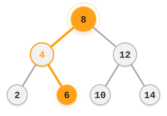
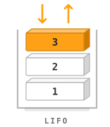
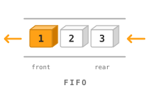

<h1 id="top">
  <picture>
    <source media="(prefers-color-scheme: dark)" srcset="assets/readme/tree-dark.svg">
    
  </picture>
  <picture>
    <source media="(prefers-color-scheme: dark)" srcset="assets/readme/title-dark.svg">
    
  </picture>
</h1>

**Data structures, algorithms, and problem solving in Java.**

I keep my DSA implementations and practice solutions here as part of my Java backend learning. I want to get better at breaking down unfamiliar problems and choosing data structures that fit the constraints. The code and explanations give me a reference for revision and technical interviews.

  <a href="#learning-map">Learning&nbsp;map</a> &nbsp;·&nbsp;
  <a href="#learning-and-practice">Learning&nbsp;&amp;&nbsp;practice</a> &nbsp;·&nbsp;
  <a href="#connected-labs">Connected&nbsp;labs</a>

<h2 id="learning-map">DSA learning map</h2>

<picture>
  <source media="(prefers-color-scheme: dark)" srcset="assets/readme/stack-dark.svg">
  
</picture>

Foundations and common patterns first, followed by trees, graphs, and dynamic programming. I’m using **[Striver’s A2Z DSA Sheet](https://takeuforward.org/prep-hub/strivers-a2z-dsa-sheet)** as my main roadmap and problem source.

<strong>01–05 · Foundations &amp; core patterns</strong>

- **[01 · Foundations](learning/01-foundations/)** — Complexity, invariants, Java collections, and overflow.
- **[02 · Arrays & strings](learning/02-arrays-and-strings/)** — Traversal, prefix sums, subarrays, and matrices.
- **[03 · Hashing](learning/03-hashing/)** — Sets, frequency maps, grouping, and prefix-sum lookups.
- **[04 · Searching & sorting](learning/04-searching-and-sorting/)** — Binary search, boundaries, sorting algorithms, and comparators.
- **[05 · Two pointers & sliding windows](learning/05-two-pointers-and-sliding-windows/)** — Sorted pairs, partitioning, and fixed or variable windows.

<strong>06–08 · Linear structures &amp; recursion</strong>

- **[06 · Linked lists](learning/06-linked-lists/)** — Reversal, fast/slow pointers, dummy nodes, and merging.
- **[07 · Stacks & queues](learning/07-stacks-and-queues/)** — Deques, bracket matching, and monotonic structures.
- **[08 · Recursion & backtracking](learning/08-recursion-and-backtracking/)** — Call state, subsets, permutations, and pruning.

<strong>09–11 · Trees, heaps &amp; greedy algorithms</strong>

- **[09 · Trees & BSTs](learning/09-trees-and-bsts/)** — Traversal, paths, BST ordering, and lowest common ancestors.
- **[10 · Heaps & priority queues](learning/10-heaps-and-priority-queues/)** — Heap operations, top-k, sorted merges, and scheduling.
- **[11 · Greedy & intervals](learning/11-greedy-and-intervals/)** — Overlaps, scheduling, correctness arguments, and counterexamples.

<strong>12–13 · Graphs &amp; dynamic programming</strong>

- **[12 · Graphs](learning/12-graphs/)** — BFS/DFS, cycles, topological order, shortest paths, and disjoint sets.
- **[13 · Dynamic programming](learning/13-dynamic-programming/)** — State, transitions, memoization, tabulation, and common DP families.

<strong>14–15 · Maths, bits &amp; advanced strings</strong>

- **[14 · Bits & maths](learning/14-bits-and-maths/)** — Bit operations, XOR, GCD, primes, and modular arithmetic.
- **[15 · Tries & string matching](learning/15-tries-and-string-matching/)** — Prefix trees, KMP, and rolling hashes.

<h2 id="learning-and-practice">Learning &amp; practice</h2>

<picture>
  <source media="(prefers-color-scheme: dark)" srcset="assets/readme/queue-dark.svg">
  
</picture>

- **[Learning](learning/)** — Data structure and algorithm implementations, with notes on the concepts behind them.
- **[Practice](practice/)** — Java problem solutions, grouped by topic, from Striver’s A2Z, LeetCode, and HackerRank.

The focus is on choosing an approach, explaining why it works, and comparing its time and space costs with alternatives. Useful edge cases and mistakes stay with the code. Java language and API experiments live in **[JAVA_LAB](https://github.com/codewithmahad/JAVA_LAB)**.

<strong>References:</strong> <a href="https://dev.java/learn/api/collections-framework/">Java collections</a> · <a href="https://docs.oracle.com/en/java/javase/25/docs/api/index.html">Java API</a> · <a href="https://github.com/codewithmahad/the-ubit-hub-resources/blob/main/resources/data-structures-and-algorithms/general/DSA_Blueprint_Part_1_Strategy_and_Roadmap_Shaikh_Mahad.pdf">My DSA Blueprint (PDF)</a>

<!-- learning-labs:start -->
<h2 id="connected-labs">How the labs fit together</h2>

I use this lab to practise problem solving in Java, from choosing data structures to reasoning about time and space complexity.
My Java language experiments live in&#8239;<a href="https://github.com/codewithmahad/JAVA_LAB"><picture><source media="(prefers-color-scheme: dark)" srcset="assets/readme/labs/java-dark.svg"></picture></a>, database work in&#8239;<a href="https://github.com/codewithmahad/SQL_LAB"><picture><source media="(prefers-color-scheme: dark)" srcset="assets/readme/labs/sql-dark.svg"></picture></a>, and Linux and Bash coursework in&#8239;<a href="https://github.com/codewithmahad/LINUX_LAB"><picture><source media="(prefers-color-scheme: dark)" srcset="assets/readme/labs/linux-dark.svg"></picture></a>.

  
  
  

<!-- learning-labs:end -->

  
    Maintained by <a href="https://github.com/codewithmahad">Shaikh Mahad</a>
    &nbsp;·&nbsp; <a href="https://shaikhmahad.vercel.app/">Portfolio</a>
    &nbsp;·&nbsp; <a href="assets/readme/README.md">Artwork credits</a>
    &nbsp;·&nbsp; <a href="#top">Back to top ↑</a>
  

