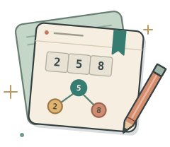

<h1 id="top">
  
  <picture>
    <source media="(prefers-color-scheme: dark)" srcset="assets/readme/title-dark.svg">
    
  </picture>
</h1>

**Java DSA practice, one weekend at a time.**

I’m working toward **Java backend development with Spring Boot**. University keeps my weekdays busy, so I use weekends to learn a topic, work through problems, and come back to the ones I struggled with.

This repo keeps my code and reasoning in one place: what I tried, where I got stuck, and what I can now explain without opening the solution. I want to solve unfamiliar problems in interviews and still understand this code when I return months later.

<p>
  <a href="#learning-map">Learning&nbsp;map</a> &nbsp;·&nbsp;
  <a href="#weekend-practice">Weekend&nbsp;practice</a> &nbsp;·&nbsp;
  <a href="#progress-and-revision">Progress&nbsp;&amp;&nbsp;revision</a> &nbsp;·&nbsp;
  <a href="#practice-profiles">Profiles</a> &nbsp;·&nbsp;
  <a href="#working-with-the-repo">Setup</a>
</p>

| Recorded here | Next up |
| :--- | :--- |
| Topic guides and practice templates. No completed practice sessions logged yet. | Complexity basics, array traversal, then a first array problem. |

<h2 id="learning-map">Learning map</h2>

My planned coverage for problem solving and backend interviews. Start with the foundations, then work through one group at a time. Each folder has a checklist I’ll update as I practise.

<details>
<summary><strong>01–05 · Foundations and everyday patterns</strong></summary>

| Folder | What I’ll cover |
| :--- | :--- |
| [01 · Foundations](topics/01-foundations/) | Complexity, dry runs, invariants, Java collections, overflow. |
| [02 · Arrays & strings](topics/02-arrays-and-strings/) | Traversal, in-place updates, prefix sums, subarrays, matrices. |
| [03 · Hashing](topics/03-hashing/) | Frequency maps, sets, duplicates, grouping, prefix-sum lookups. |
| [04 · Searching & sorting](topics/04-searching-and-sorting/) | Binary search, boundaries, merge sort, quicksort, comparators. |
| [05 · Two pointers & sliding windows](topics/05-two-pointers-and-sliding-windows/) | Sorted pairs, partitioning, fixed and variable windows. |

</details>

<details>
<summary><strong>06–08 · Links, queues, and recursive thinking</strong></summary>

| Folder | What I’ll cover |
| :--- | :--- |
| [06 · Linked lists](topics/06-linked-lists/) | Reversal, dummy nodes, fast/slow pointers, merging. |
| [07 · Stacks & queues](topics/07-stacks-and-queues/) | Deques, monotonic stacks, parentheses, queue behaviour. |
| [08 · Recursion & backtracking](topics/08-recursion-and-backtracking/) | Call trees, base cases, subsets, permutations, pruning. |

</details>

<details>
<summary><strong>09–11 · Trees, priorities, and greedy choices</strong></summary>

| Folder | What I’ll cover |
| :--- | :--- |
| [09 · Trees & BSTs](topics/09-trees-and-bsts/) | DFS/BFS, height, paths, BST ordering, lowest common ancestor. |
| [10 · Heaps & priority queues](topics/10-heaps-and-priority-queues/) | Heap operations, top-k, merging sorted inputs, scheduling. |
| [11 · Greedy & intervals](topics/11-greedy-and-intervals/) | Merge/overlap, scheduling, local choices and counterexamples. |

</details>

<details>
<summary><strong>12–13 · Graphs and dynamic programming</strong></summary>

| Folder | What I’ll cover |
| :--- | :--- |
| [12 · Graphs](topics/12-graphs/) | Traversal, grids, cycles, topological order, shortest paths, DSU. |
| [13 · Dynamic programming](topics/13-dynamic-programming/) | State and transitions, memoization, tabulation, common DP families. |

</details>

<details>
<summary><strong>14–15 · Supporting tools and later depth</strong></summary>

| Folder | What I’ll cover |
| :--- | :--- |
| [14 · Bits & maths](topics/14-bits-and-maths/) | Bit operations, XOR, GCD, primes, modular arithmetic. Revisit alongside earlier topics. |
| [15 · Tries & string matching](topics/15-tries-and-string-matching/) | Prefix trees, prefix lookup, KMP, rolling-hash basics. After the core groups. |

</details>

For Java, I also want to explain **why I chose a collection**, what its operations cost, and where ordering, hashing, or mutability can cause trouble.

<h2 id="weekend-practice">Weekend practice</h2>

1. **Pick up where I left off.** Read the last log entry and retry one problem before looking at its solution.
2. **Work on one topic.** Trace a small example, write the approach, and check normal and awkward inputs. Use a hint or editorial when needed, then record what helped.
3. **Leave a clear next step.** Save the code, note the mistake or insight, and choose what to revisit next weekend.

During a busy university week, a short revision session is still useful. The [weekend log](progress/README.md) keeps the next step visible when I return.

<h2 id="progress-and-revision">Progress &amp; revision</h2>

**[Weekend log →](progress/README.md)** &nbsp;·&nbsp; **[Revision queue →](progress/revision.md)**

Each log entry links to the actual work. Problem notes keep the approach, complexity, checks, and any help I used. A revisit means trying again before opening the old code.

<details>
<summary><strong>When I update a problem’s state</strong></summary>

| State | What it means here |
| :--- | :--- |
| **Planned** | Folder or note created; no attempt recorded. |
| **Attempted** | I worked on it and recorded the approach or the point where I got stuck. |
| **Checked** | The implementation runs, I recorded its checks and complexity, and I can explain why it works. |
| **Revisited** | I returned in a later session, attempted it without the old solution, and recorded the result. |

Platform acceptance is recorded separately when I actually submit. A checked solution can still need revision, especially if I relied on an editorial.

</details>

<h2 id="practice-profiles">Practice profiles &amp; references</h2>

<p>
  <a href="https://leetcode.com/u/mahad2006/"></a>
  <a href="https://codolio.com/profile/codewithmahad"></a>
</p>

I’ll use [**Striver’s A2Z sheet**](https://takeuforward.org/prep-hub/strivers-a2z-dsa-sheet) for topic coverage and problem selection, then keep my Java attempts here. The sheet’s order is a reference; I’ll slow down when a topic needs more work.

For Java details: [Collections framework](https://dev.java/learn/api/collections-framework/) · [Java SE 25 API](https://docs.oracle.com/en/java/javase/25/docs/api/index.html). My [DSA Blueprint](https://github.com/codewithmahad/the-ubit-hub-resources/tree/main/resources/data-structures-and-algorithms/general) is in The UBIT Hub Resources.

<h2 id="working-with-the-repo">Working with the repo</h2>

**Java · IntelliJ IDEA · Git** — independent programs, with the notes beside the code. My local JDK is **25**; I’ll keep platform submissions within the Java version the problem supports.

<details>
<summary><strong>Where things go</strong></summary>

| Location | Purpose |
| :--- | :--- |
| [`topics/`](topics/) | Numbered topic guides; concept experiments in `learning/`, problems in `problems/`. |
| [`progress/`](progress/README.md) | Weekend log and revision queue. |
| [`templates/`](templates/) | A problem note and an unfinished Java runner to copy. |
| [`scripts/`](scripts/) | One PowerShell helper to create a problem folder. |

Each problem gets its own folder. A solution can appear in several sheets; I keep one copy and link to it. The [workflow guide](docs/WORKFLOW.md) has naming, run commands, and the first-session plan.

</details>

<details>
<summary><strong>Start a problem</strong></summary>

From the repo root in PowerShell, for example:

```powershell
.\scripts\new-problem.ps1 -Topic 02 -Name lc-0217-contains-duplicate
```

This creates a **planned** problem with a note and `Main.java`; it leaves existing work alone. Fill in the source link and approach, then add the implementation and explicit checks. The unfinished runner deliberately throws until I replace it.

Run that file directly with the JDK:

```powershell
java topics/02-arrays-and-strings/problems/lc-0217-contains-duplicate/Main.java
```

I edit in IntelliJ and run one problem at a time with the commands above. See the [setup and workflow](docs/WORKFLOW.md) for manual copying and PowerShell details.

</details>

---

<p align="center">
  <strong>Shaikh Mahad Ud Din</strong> · Java Backend Development<br>
  <sub><a href="https://github.com/codewithmahad/JAVA_LAB">Java Lab</a> &nbsp;·&nbsp; <a href="https://github.com/codewithmahad/SQL_LAB">SQL Lab</a> &nbsp;·&nbsp; <a href="https://shaikhmahad.vercel.app/">Portfolio</a> &nbsp;·&nbsp; <a href="assets/readme/README.md">Artwork</a> &nbsp;·&nbsp; <a href="#top">Back to top ↑</a></sub>
</p>
